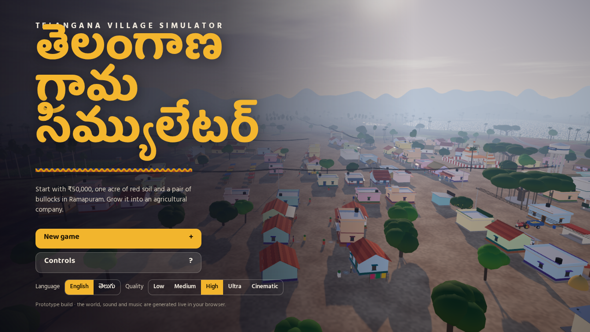
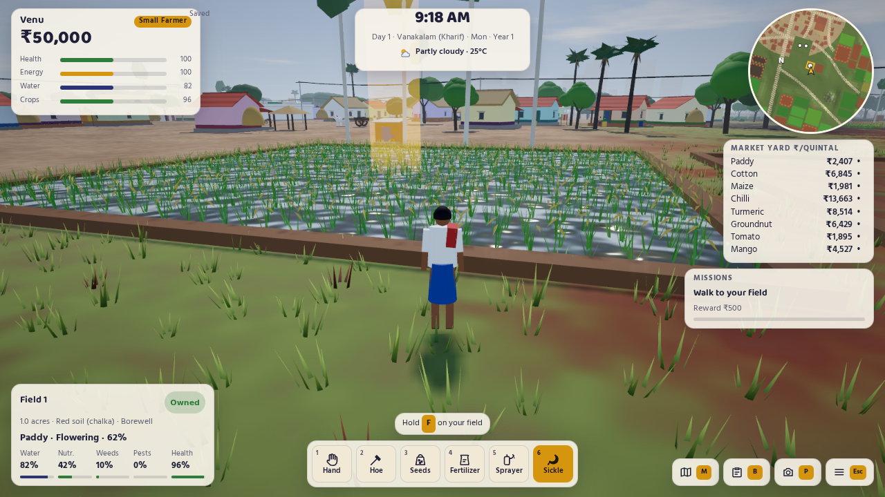
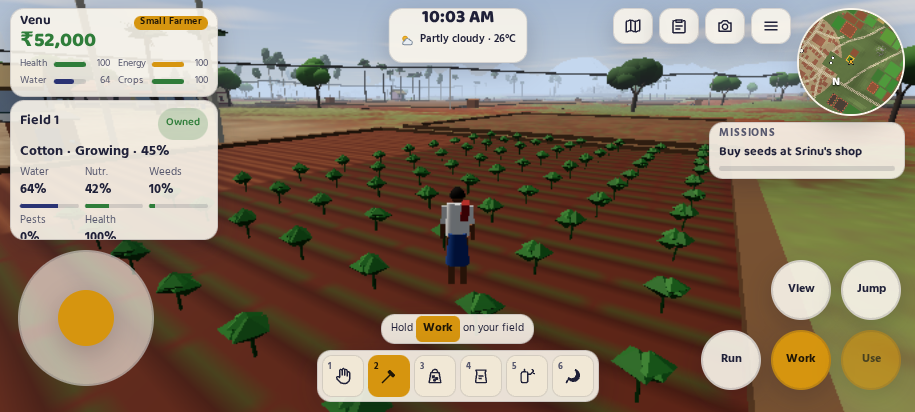
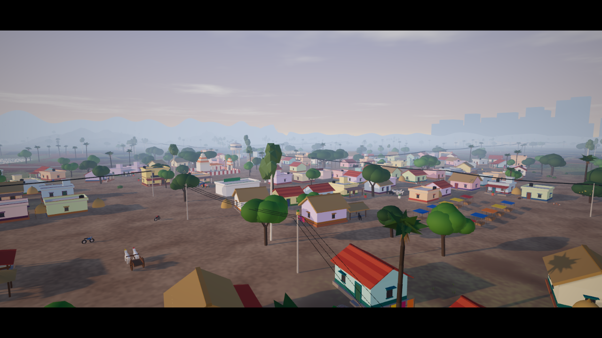

# Indian Village Simulator · भारतीय गाँव सिम्युलेटर

A 3D open-world farming game set in a Telangana village. You start in Ramapuram with ₹50,000, one acre of red soil, a pair of bullocks and a small house. Grow paddy, cotton and chilli, sell at the market yard, and build your farm into an agricultural company.

₹50,000, ఒక ఎకరం ఎర్ర నేల, ఒక ఎడ్ల జతతో రామాపురంలో మొదలుపెట్టండి. దాన్ని వ్యవసాయ కంపెనీగా ఎదిగించండి.

It runs in the browser on PC and on phones, in English, हिन्दी, বাংলা, मराठी, తెలుగు, தமிழ் and ಕನ್ನಡ (pick on the title screen or in the Menu). There is nothing to install.



| Your field | On a phone |
| --- | --- |
|  |  |



## Play

**Play now: <https://peru-dove-641366.hostingersite.com>** (free, nothing to install)

Works on Android phones, iPhones, iPads, tablets and computers, in any modern browser (Chrome, Safari, Edge, Firefox).

- **iPhone / iPad:** open the game in Safari (iOS 15 or newer), tap **Share → Add to Home Screen**, then start it from the home screen. It opens full screen like an app. Sound plays even with the silent switch on (use the volume buttons or Menu → Audio). If a phone ever runs out of memory, the next start switches to light graphics by itself, and if the game cannot start, the loading screen says why and offers **Try again**.
- **Android:** the game goes full screen when you tap Start. You can also use Chrome's **Install app / Add to Home screen**.
- **Turn the phone sideways** for the best view. Phones start on the Low quality setting so the game stays smooth.
- **Just follow the coach:** the yellow strip at the bottom and the mission card always say the next step ("Go to your field", "Hold Work", "Tap Buy seeds"), and the gold arrow shows the way. The steps can also be read aloud (Menu → Voice guide).
- **Helpers (optional):** in Menu → Helpers you can turn on a "▶ Do it for me" button and tap-the-ground-to-walk. They are off by default so you farm yourself.

- **Online:** once GitHub Pages is turned on for this repository (Settings → Pages → Deploy from branch → `main`, folder `/root`), the game is at `https://venuikkada.github.io/Telangana-village-simulator-/`.
- **On your computer:** open `index.html` in Chrome, Edge or Firefox. An internet connection is needed the first time, for three.js and the fonts. If your browser blocks it, run `npx serve .` in this folder and open the address it prints.

## What's in the game

- **The world:** Ramapuram village with its temple, school, panchayat office, tea stall, seed shop, kirana, tractor workshop, health centre and weekly santha. There is also the smaller village of Seethampet, Nagaram town with the bank and tractor showroom, the agricultural market yard, a highway with a petrol bunk and dhaba, the lake, the canal, borewells, granite hills, palm and neem trees, power lines and transformers.
- **Farming:** plough, cultivate, sow, irrigate with the borewell pump or the canal gate, fertilize, weed, spray pests and harvest. Each field tracks water, nutrients, weeds, pests and crop health. Red and black soils suit different crops.
- **Crops:** paddy, cotton, maize, chilli, turmeric, groundnut and tomato, plus a mango orchard.
- **Seasons and weather:** Vanakalam (Kharif), Yasangi (Rabi) and Endakalam (Summer). Weather includes monsoon rain, thunderstorms with lightning, heat waves, gusty winds, morning mist, droughts and power cuts. There is a full day and night cycle with moon phases.
- **Selling and money:** prices move with supply, demand, the season and news events. You can sell at the market yard, at MSP at the government procurement centre (paid after two days), to the village trader or at the Sunday santha. Store your harvest at home or in a warehouse or cold storage, but it can spoil. Bank crop loans, the moneylender and the farmer investment support payment are all there.
- **Machines:** a bullock cart and wooden plough, an old moped, a motorcycle, two tractors, a pickup van and a combine harvester. Tractor implements are the MB plough, cultivator, rotavator, seed drill, fertilizer spreader, boom sprayer, trailer and water tanker. You can also rent a tractor or hire a combine harvester.
- **Growing the farm:** buy or lease land in two villages and drill borewells. Upgrade the house through five levels, from a small village house to an agricultural estate. Build a water tank, farm pond, solar pump, warehouse, cold storage, polyhouse, dairy shed, machinery garage and worker quarters.
- **Workers:** daily labourers, permanent farmhands and tractor drivers who take your tractor to the field.
- **Village development:** fund CC roads, street lights, a drinking water tank, a shopping complex, a school, the health centre, canal lining, a village godown and a market expansion.
- **Ranks:** Small Farmer → Successful Farmer → Large Farmer → Agricultural Business Owner → Village Agribusiness → Agricultural Company.
- **Missions:** an eight-step tutorial (you can skip it), then farm goals that adapt to your farm, plus pest attacks, droughts and the festivals Bonalu, Bathukamma, Sankranti and Ugadi.
- **Mission after mission:** one mission at a time on the card at the top right, and the next one comes right after it, for ever. Farm work and fun take turns: plough the field, then a cup of chai at Yadamma's stall; sow, then ring the temple bell; harvest, then hit a six in gully cricket, chase Ranga's runaway rooster, get your things back from the naughty monkey, cannonball into the lake, do the chicken dance... Each mission has a little story and a reward, ▶ **Play** starts a mini-game straight away, ⏭ swaps a mission you don't fancy, and every five in a row pays a ₹2,500 bonus. During the tutorial the fun comes as breaks between the lessons and while the crop grows.
- **Today's tasks:** every morning brings five new tasks: one farm job, one in the village (chai at the tea stall, the temple, the bus, your dog), two fun ones (hit a six, cut kites, catch fish, Holi, the rooster, the monkey, a lake jump) and one trip (the helicopter, the jeep, a new place). Each pays a reward, all five pay a ₹3,000 bonus, and you can swap one task a day.
- **Village life:** up to about 70 villagers with daily routines, including the sarpanch, the seed shop owner, the mechanic, the doctor, the moneylender and the shepherd. There are cattle, buffaloes, goats, sheep, dogs, chickens and birds, plus buses, lorries, autos and motorbikes on the roads.
- **Sharper look on phones:** people have rounded bodies, real faces (eyes, brows, nose, lips), necks, hands and ears; phones now draw a sharp picture with sun shadows, clearer air and richer colours, and step back by themselves if the phone is slow. Rain is only a soft background sound, and a brighter song plays while you work the field.
- **Developed by Venu Brushwood** (shown on the loading and title screens).
- **Sound and music:** wind, rain, crickets, temple bells, engines and animals, and a little village band playing live: tanpura drone, bansuri flute with gentle glides, santoor, tabla and a soft harmonium. Every song has a tune that comes back (intro, A, A, B, A) in a raga for the time of day: Mohanam in the morning, Madhyamavati at noon, Hamsadhwani by the lake in the evening, a Hindolam lullaby at night, santoor in the monsoon rain, and faster songs for festivals and mini-games. All of it is generated in the browser.
- **Easy to play:** one Auto button does the next job on your field: plough, sow, water, feed, weed, spray or harvest. Missing seeds or fertilizer? One tap gets them delivered to the field. When the crop is growing, "Rest" jumps ahead to the next thing it needs.
- **Never lost:** a gold arrow and an on-screen marker always point to your next goal. The minimap faces north and shows shops, roads and your fields. On the full map, tap any place and take an auto straight there.
- **Graphics:** Low, Medium, High, Ultra and Cinematic presets. Phones start on Low and run at a steady 60 or 30 FPS ("Auto" picks what the phone can hold). Far trees and fields switch to lighter models, and resolution adjusts automatically to keep the game smooth.
- **Your mission in the corner:** the card at the top right shows the current mission and the next step, and the gold arrow points the way. Tap the card for the full list: the mission, today's tasks and the bigger farm goals. Want help with a farm goal? Tap **Guide me** and the card and the gold arrow show you each step until you stop guiding.
- **Compulsory rest:** after about 4 hours of work (5 in Easy mode) your farmer must rest for 3 to 5 hours before working again. Tap **😴 Rest** (it replaces the Work button) or press R; the hours pass and you wake up fresh. A night's sleep resets it too.
- **Daytime only:** play runs from 6:30 in the morning to 6 in the evening; then the night passes by itself and a sunny new morning begins.
- **Celebrations:** every finished mission gets confetti, three stars, a cheer and coins flying into your wallet. Trophies and new ranks too.
- **Flowers and butterflies** around the village and the fields.
- **Easy mode:** new games start in Easy mode, made for kids and first-time players: crops dry out, get weedy and catch pests about half as fast, a neglected crop still gives a fair harvest, and the farmer tires more slowly. Switch between Easy and Normal any time in the Menu.
- **How to play:** four picture cards the first time you play (Move, Follow the gold arrow, Do it for me, Gifts & trophies). Open them again from the Menu.
- **Daily gift:** come back every day for a gift that grows over a 7-day streak, from ₹1,000 and fertilizer to seeds and ₹10,000 on day 7.
- **Trophies:** 21 trophies, from "First seeds" and "Lakhpati" to "Tractor owner" and "Crorepati", each with a cash reward. See them in Farm office → Trophies.
- **Your own dog:** adopt Moti, Kalu or Tommy at your house for free. Your dog follows you everywhere, even beside your tractor, and patting it gives you energy.
- **Photos and sharing:** photo mode has a Take photo button. The picture gets the game's name and link and can be saved, shared or sent on WhatsApp. "Invite friends" in the Menu shares the game link.
- **Saving:** the game saves every morning, after you sleep and every few minutes, in your browser.
- **Sign in with email:** tap **👤 Sign in** on the title screen (or Menu → Account) and create a free account with your email and a password. Your farm is then also saved online, so you can continue on any phone or computer: sign in there and tap Continue. If two devices both played, the game asks which farm to keep. Forgot your password? Get a 6-digit code by email and set a new one. You can sign out or delete your account any time.
- **Free rides to explore everything:** a hatchback car, a yellow taxi, an open jeep that goes off-road, a scooter, a bicycle, a go-kart, a racing bike, an auto rickshaw, the village bus, a lorry and a **helicopter** on its own helipad, all parked near your house. In the helicopter, Up and Down (Space / C) change height and the stick or arrows fly and turn; it hovers when you let go and lands gently. Cars now drive on the roads too.
- **Dress up your farmer:** 🎉 Fun → 👕 Dress up opens a dressing room with a live view of your farmer: man or woman, skin, hair colour (even blue or red), turban or cap, sunglasses, mustache or bindi, top colour, lungi, dhoti, pants, shorts, saree or salwar, a towel or dupatta, height and build. 🎲 Surprise me picks a random look.
- **Funny moves:** the 🎉 Fun button (T on a computer) has 17 moves: wave, namaste, dance, folk dance, clap, laugh, show muscles, chicken dance, cartwheel, spin, jump for joy, yoga, selfie, facepalm, sit down, nap and **Holi colours**. Villagers nearby wave back, clap, laugh or join your dance, with a dhol beat. Holi throws a cloud of gulal: everyone near you turns pink, green and yellow and starts dancing.
- **More time to explore:** days now run at half speed (about 8 minutes from morning to evening), with ¼× to 8× in Menu → Basic. **Explore mode** stops the clock and tiredness so you can roam as long as you like.
- **Mini-games** (🎉 Fun, one big gold button for each; F on a computer). Each has its own scene: a rolled cricket pitch with chalk creases, stumps and bails at both ends, boundary flags, village kids fielding and a camera that chases your sixes; two-colour patang kites with tassel tails, pink manja and a sky full of Sankranti kites; a bamboo rod that bends, a red-and-white float, ripples on the water and a basket that fills with fish:
  - 🪁 **Kite fights:** turn the camera to steer your kite, hold **Dive** to swoop onto another kite and cut it (₹150, "Kai po che!"). Now and then a kite swoops at yours: dive first or your string is cut.
  - 🏏 **Gully cricket:** six balls at the open ground. Tap **Hit** as the ball reaches you: perfect timing is a SIX and the villagers dance. ₹30 a run, and your best score is kept.
  - 🎣 **Fishing at the lake:** wait for the red float to dip, then tap **Pull**. Rohu, katla, murrel, prawns and, rarely, a golden fish worth ₹2,500.
  - 🐓 **Rooster chase:** a rooster gets loose; run after it as it zig-zags and flaps, and tap **Catch** when you are close (₹400).
  - 💦 **Lake jump:** at the lake ghat your farmer runs, does a cannonball into the water, swims back and climbs out dripping (₹300 once a day, +15 energy).
  - 🐒 **Naughty monkey:** now and then a monkey snatches your cap (or your lunch box) and runs up a tree. Follow the gold arrow and throw it a banana to get your things back (₹300).
  - 🎡 **Lucky wheel:** one free spin every day for money, seeds, fertilizer, a golden turban or a map to a golden mango.
- **Fun activities:** 30 **golden mangoes** hidden all over the map (₹500 each, a big prize for all 30, and a "show me the nearest" hint), **places to discover** (₹200 each), and three **checkpoint races** (Village loop, Lake and hill ride, Highway dash) for any vehicle or on foot, with gold, silver and bronze medals and your best times.
- **Settings like the big mobile games:** the Menu has six tabs.
  - **Basic:** language, difficulty, game speed, minimap on or off, helpers and full screen.
  - **Graphics:** quality (Smooth, Balanced, HD, Ultra HD, Cinematic), frame rate (Auto, 30, 40, 60, 90, 120), five colour styles (Classic, Colorful, Realistic, Soft, Movie), brightness and an FPS counter.
  - **Controls:** **Customize layout** lets you drag every touch button (and the walking stick) anywhere and make each one bigger, smaller or more see-through, separately for walking and for driving. There are also overall button size and transparency, a fixed or floating joystick (put your thumb anywhere on the left side), buttons or the stick for vehicles, auto run on or off, and vibration.
  - **Sensitivity:** camera speed on foot and in vehicles, invert camera, camera follow, and a **gyroscope**: turn and tilt the phone to look around, with its own sensitivity.
  - **Audio:** master, music, ambience and effects volume, plus the voice guide.
  - **Account:** login, sign up and your online farm.
- **How accounts are kept safe:** passwords and reset codes are stored only as bcrypt hashes, sign-ins use random tokens stored only as hashes, wrong-password and reset attempts are rate-limited, and the account data lives outside the website folder (`api/account.php`, SQLite). The claude.ai version links to the website for signing in.

## Controls

| PC | Phone | Action |
| --- | --- | --- |
| W A S D | Left stick | Walk or drive |
| Shift | Run, or push the stick all the way | Run |
| = | Push the stick up and slide onto the runner above it | Auto run (steer with the camera; touch the stick to stop) |
| Mouse drag, wheel | Drag the screen, pinch | Look around, zoom |
| E | Use, or tap the prompt | Talk, use shops, buy seeds, rest, get in and out of vehicles |
| F (hold) | Work (hold) | Auto: does the next job on your field |
| F | Big gold button | In a mini-game: Dive, Hit, Pull or Catch |
| R | 😴 Rest | Rest when your farmer is too tired to work |
| J | Tap the mission card | Your mission, today's tasks and farm goals |
| 1 – 6 | Tool bar | Auto, hoe, seeds, fertilizer, sprayer, sickle |
| Q | Type | Switch seed, fertilizer or spray |
| G | Lower / Raise | Lower or raise the implement |
| H / L | Horn | Horn / headlights |
| V | View | First or third person |
| M, B, P, Esc | Top buttons | Map, farm office, photo mode, menu |
| Enter | ▶ Do it for me | The game does the next step for you |
| – | Tap the ground | Walk there |

Follow the gold arrow. Sleep at home to skip the night, or use "Rest" on your field while the crop grows.

## Build from source

```bash
npm install
npm run build     # writes index.html and dist/
npm run check     # build + syntax check + lint
```

The browser tests drive the game in headless Chromium. They need Playwright's Chromium: run `npx playwright install chromium` once, then `npm test` or `npm run test:mobile`.

## Project layout

| File | What it does |
| --- | --- |
| `src/page.html` | Page shell: styles, HUD, menus, touch controls, title and loading screens |
| `src/js/00_core.js` | three.js import, maths, seeded random, noise, language and money helpers, event bus |
| `src/js/01_data.js` | Seasons, festivals, weather, crops, items, machines, upgrades, ranks, names |
| `src/js/02_render.js` | Renderer, quality presets, shared shader effects, post-processing |
| `src/js/03_sky.js` | Sky, sun and moon, day and night lighting, fog, lightning |
| `src/js/04_terrain.js` | Terrain, field layout, roads, lake, canal, collisions |
| `src/js/05_builder.js` | Geometry builder, world chunks, Telugu sign boards |
| `src/js/06_buildings.js` | Houses, temple, school, shops, workshop, market yard and other buildings |
| `src/js/06b_village.js` | Places Ramapuram, Seethampet, Nagaram town and the landmarks |
| `src/js/07_vegetation.js` | Trees, grass, boulders |
| `src/js/08_fields.js` | Field tiles, crop growth, water, nutrients, weeds, pests |
| `src/js/09_characters.js` | People, animals and birds with procedural animation |
| `src/js/10_npc.js` | Road paths, villager routines, animal behaviour |
| `src/js/11_vehicles_models.js` | Tractor, harvester, bike and implement models |
| `src/js/11b_vehicles.js` | Driving, implements, traffic, AI field work, particles |
| `src/js/12_player.js` | Input, player, cameras, interactions |
| `src/js/12b_auto.js` | "Do it for me" autopilot and tap-to-walk |
| `src/js/13_time_weather.js` | Clock, calendar, weather, rain |
| `src/js/14_economy.js` | Money, market prices and news, storage, loans |
| `src/js/14b_farm.js` | Land, house, upgrades, dairy, workers, village projects, services, ranks |
| `src/js/14c_extras.js` | Daily gift, trophies, pet dog, photo sharing, easy mode, how-to-play cards |
| `src/js/15_missions.js` | Tutorial and generated missions |
| `src/js/15b_coach.js` | Step-by-step coach, gold guide arrow, spoken instructions |
| `src/js/16_audio.js` | Ambience, spatial sounds, engines, sound effects |
| `src/js/16b_music.js` | The background music: a live village band (tanpura, bansuri, santoor, tabla, harmonium) |
| `src/js/17_ui.js` | HUD, map, menus, shops, dialogue, settings, touch controls |
| `src/js/12c_fun.js` | Dressing room, funny moves, Explore mode, golden mangoes, places to discover, races |
| `src/js/12d_games.js` | Mini-games: Holi colours, kite fights, gully cricket, fishing, rooster chase, lake jump, the naughty monkey, the daily lucky wheel |
| `src/js/15c_tasks.js` | Today's tasks (the task list) and the compulsory rest |
| `src/js/15d_chain.js` | Mission after mission: farm work and funny village tasks taking turns on the corner card |
| `src/js/17c_menu.js` | The Menu tabs, graphics styles, button layout editor, floating joystick, gyroscope |
| `src/js/18_save.js` | Browser and cloud saves |
| `src/js/18b_account.js` | Sign in / sign up with email, password reset, keeping the farm in step with the account |
| `api/account.php` | The account server (PHP + SQLite) that runs on the website |
| `src/js/19_main.js` | World build, game start, simulation clock, main loop |
| `tools/build.mjs` | Joins everything into `index.html` |
| `tools/*.cjs` | Headless browser tests and screenshot scripts |

The only libraries are [three.js](https://threejs.org) 0.170, loaded from jsDelivr, and the Google Fonts Baloo Tammudu 2 and Hind Guntur. Every model, texture, sound and piece of music is generated in code, so the game has no image or audio files.

---

© 2026 venuikkada. All rights reserved.
